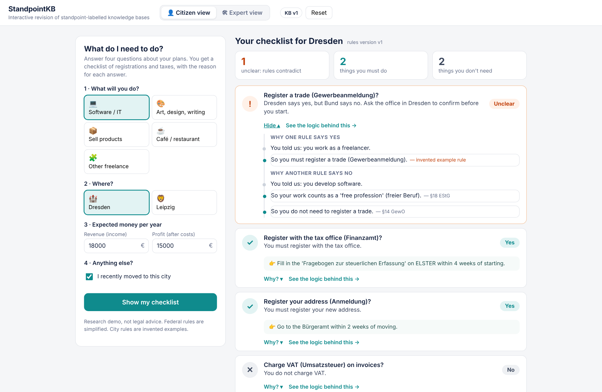
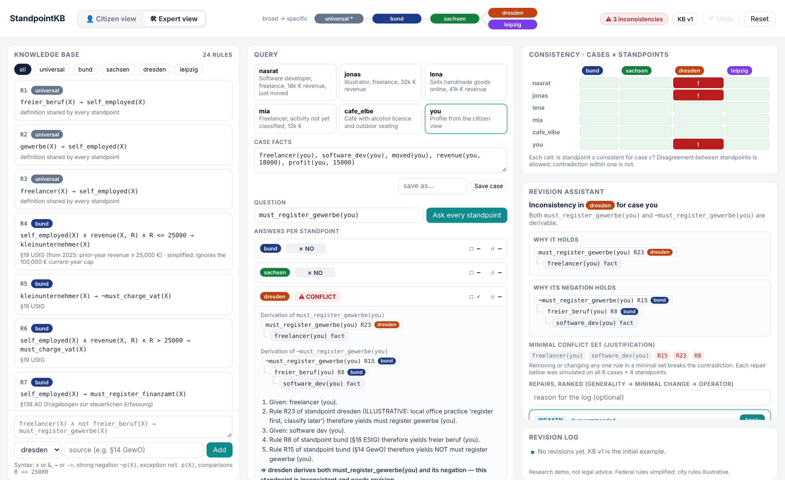
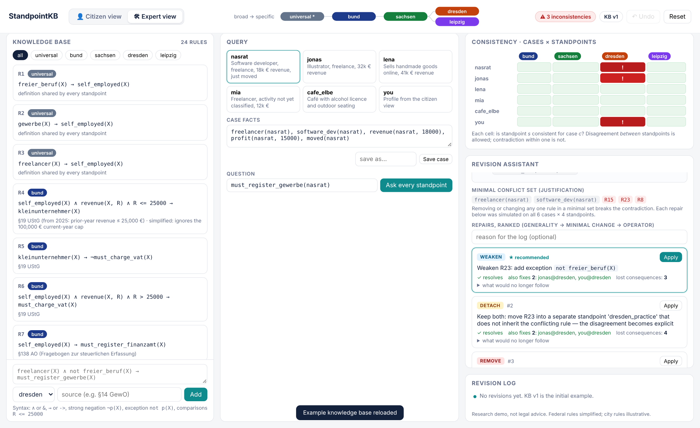
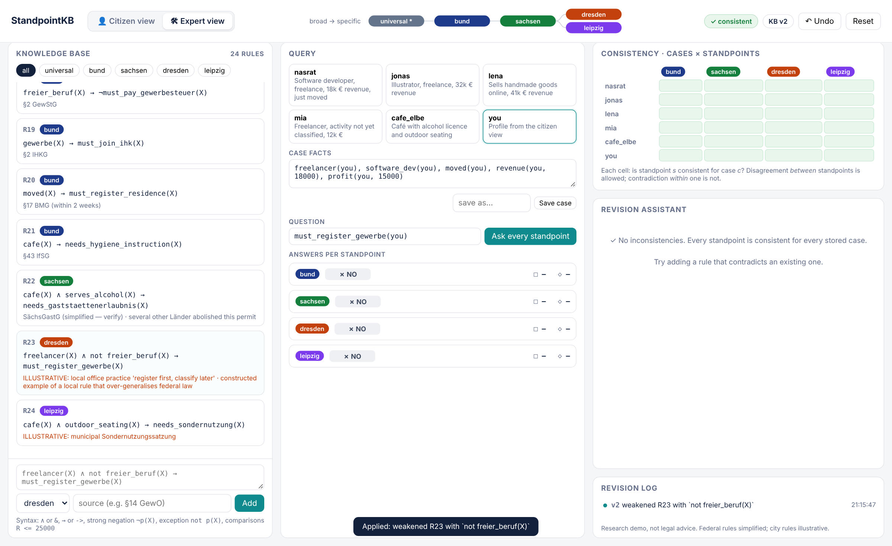
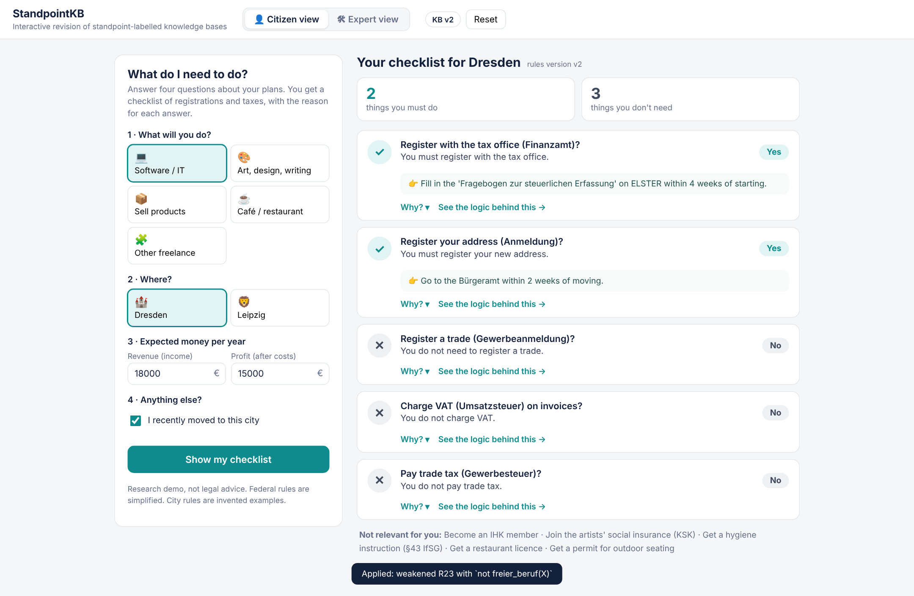

# StandpointKB

A small prototype for revising rule bases where rules come from different authorities that do not
always agree.

The example is starting self-employed work in Germany. Federal law, the state of Saxony and the
cities of Dresden and Leipzig each have rules. Most of the time they fit together. Sometimes a
local rule contradicts a federal one. StandpointKB finds those contradictions, shows exactly which
rules cause them, suggests ways to fix them, and explains the answers to an ordinary user.

It grew out of [Klawego](https://klawego.com), a live platform I built that helps people in Germany
with official letters, deadlines and guided cases for five life situations. Klawego's guidance rests
on rules from federal, state and local authorities, and keeping those rules consistent is the
problem this prototype explores. StandpointKB is a prototype of the rule layer Klawego needs.

```
*  (universal)
└── bund                 federal law
    └── sachsen          Saxony
        ├── dresden      city
        └── leipzig      city
```

A city inherits all rules of Saxony and the Bund. A rule written for Dresden does not apply in
Leipzig or at federal level.

> Not legal advice. The federal rules are simplified versions of real law, with the source shown
> next to each rule. The city rules are invented examples and are marked `ILLUSTRATIVE`.

## Walkthrough

**1. Citizen view.** A freelance software developer in Dresden fills in four questions and gets a
checklist. Business registration comes back as *Unclear*: the Dresden rule says yes, federal law
says no. "Why?" shows both chains of reasoning, with the law behind each step.



**2. Expert view.** "See the logic behind this" opens the same conflict for the person who
maintains the rules: every rule with its standpoint, the answer of each standpoint, the proof
trees, and a grid of which standpoints are inconsistent for which cases.



**3. Ranked repairs.** The revision assistant shows the minimal set of rules responsible for the
contradiction and lists possible repairs. Each repair is tested on every stored case before it is
ranked. The top suggestion adds an exception to the Dresden rule ("unless the work is a free
profession"). This also fixes the same conflict for the illustrator, and keeps the rule for
people whose work is not classified.



**4. After the repair.** One click applies it. All standpoints are consistent again, and the
change is in the revision log (with undo).



**5. Back to the citizen.** The same question now has a clear answer.



## Run it

Python 3.9 or newer. No other dependencies.

```bash
python3 server.py                             # open http://127.0.0.1:8000
python3 -m unittest discover -s tests -t .    # 27 tests
```

## How it works

**Rules.** Datalog with variables, recursion, number comparisons, strong negation (`¬p(X)`, "it
is explicitly not the case") and exceptions (`not p(X)`, "unless p is known"). Exceptions must be
stratified, i.e. no rule may depend on its own exception.

**Standpoints.** Every rule has a standpoint label. Standpoints are ordered by *sharpening*:
`dresden ≼ sachsen ≼ bund`. A standpoint uses its own rules plus those of every broader
standpoint. For a question φ:

* "according to s, φ" holds if φ can be derived from the rules of s;
* "according to s, φ is possible" holds if ¬φ cannot be derived.

A contradiction is only a problem *inside* one standpoint. If Dresden says yes and Leipzig says
no, both are consistent; they simply disagree, and the tool reports it that way.

**Explanations.** Every answer comes with a proof tree. The citizen view turns the same tree into
plain sentences.

**Conflict sets.** For a contradiction p / ¬p, the tool collects the rule sets that derive each
side and keeps the smallest combinations. Changing any one rule in such a set removes the
contradiction. In ontology research these are called justifications.

**Repairs.**

| Repair | What it does |
|---|---|
| remove | delete the rule |
| weaken | add an exception, so the rule applies in fewer cases |
| narrow | move the rule to a more specific standpoint, so it stops applying elsewhere |
| detach | move the rule to a new, separate standpoint, so both views are kept as an open disagreement |

Classical belief revision only has the first two. Narrow and detach change *where* a rule holds
instead of *whether* it holds.

**Ranking.** Each repair is applied to a copy of the rule base and checked against all cases and
all standpoints. Repairs that leave the conflict or create a new one are marked as not
admissible. The rest are sorted by: (1) how many other conflicts they also fix, (2) how few
conclusions are lost, (3) weaken before narrow before detach before remove.

## Limitations

* Only a small fragment of standpoint logic: one label per rule, no nested modalities, no
  description logic.
* Conflict sets track positive dependencies only. A conflict caused by a missing fact (through an
  exception) is not fully captured.
* The search for conflict sets is capped, so on large inputs it may miss some.
* "Lost conclusions" are counted on the stored cases only.

## Questions this raises

1. Which of the classical revision postulates (AGM, Katsuno–Mendelzon) do *narrow* and *detach*
   satisfy?
2. What should happen when the standpoint hierarchy itself changes, e.g. a new authority is added?
3. How should competing repairs be ranked: minimal change, the rank of the authority (*lex
   superior*, *lex specialis*), or the user's choice?
4. Can these repairs be lifted to Standpoint EL while staying tractable?
5. How can one proof be explained differently to an expert and to a citizen?

## Files

```
standpointkb/engine.py     rules, standpoints, reasoner, proofs, conflict sets
standpointkb/revision.py   repair operators, simulation, ranking, undo
standpointkb/plain.py      citizen view: profile → facts, proof → plain sentences
standpointkb/explain.py    text explanations (optional language-model rephrasing, off by default)
standpointkb/seed.py       example rules and cases
server.py                  web server and JSON API
web/index.html             user interface
tests/                     unit tests
```

## References

* L. Gómez Álvarez, S. Rudolph. Standpoint logic: multi-perspective knowledge representation. FOIS 2021.
* L. Gómez Álvarez, S. Rudolph, H. Strass. How to agree to disagree: managing ontological perspectives using standpoint logic. ISWC 2022.
* L. Gómez Álvarez, S. Rudolph, H. Strass. Tractable diversity: scalable multiperspective ontology management via Standpoint EL. IJCAI 2023.
* C. Alchourrón, P. Gärdenfors, D. Makinson. On the logic of theory change. Journal of Symbolic Logic, 1985.
* H. Katsuno, A. Mendelzon. Propositional knowledge base revision and minimal change. Artificial Intelligence, 1991.
* R. Reiter. A theory of diagnosis from first principles. Artificial Intelligence, 1987.
* F. Baader, R. Peñaloza. Axiom pinpointing in general tableaux. Journal of Logic and Computation, 2010.

---

Nasratullah Nejat, November 2026. The code was written with the help of an AI coding assistant;
the problem, the domain model and the design are my own.
